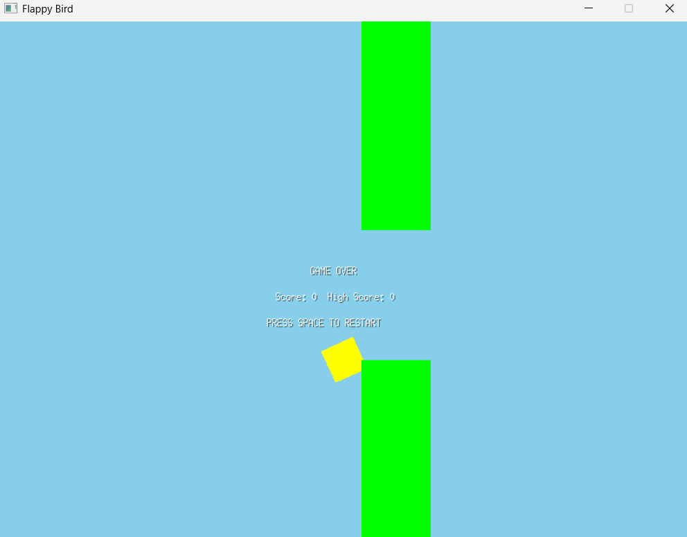

# Flappy Bird in Go

[](https://golang.org/dl/)
[](https://ebiten.org/)
[](https://opensource.org/licenses/MIT)

A Flappy Bird clone implemented in Go using the Ebiten v2 game engine. All visuals are procedurally drawn colored rectangles — no sprites, assets, or audio. Desktop only, keyboard controls.

This project was created using the [OpenRouter](https://openrouter.ai) model `deepseek/deepseek-r1-0528:free` through Cline extension, with a prompt-driven development process that emphasized iterative planning and implementation.



## Features

- Bird physics with gravity, flap mechanics, and rotation smoothing
- Randomly generated green pipe pairs with gaps
- AABB collision detection (pipes, ground, ceiling)
- Score tracking with session-based high score (not persisted to disk)
- Three game states: Start Screen, Play, Game Over
- Procedural rendering — no external assets required
- Fixed 800x600 window, 60 FPS game loop

## Installation

### Prerequisites

- Go 1.24.4 or higher

### Quick Start

```bash
git clone https://github.com/francojeferson/flappy-bird-go.git
cd flappy-bird-go
go run .
```

Or build a standalone executable:

```bash
go build -o flappy-bird.exe .
./flappy-bird.exe
```

## How to Play

1. Press **SPACE** on the start screen to begin
2. Press **SPACE** repeatedly to make the bird flap upward
3. Navigate through the green pipe gaps to score points
4. Avoid hitting pipes, the ground, or the ceiling
5. On game over, wait half a second, then press **SPACE** to restart. The game ignores **SPACE** until then, so you can read the score.

Each gap passed scores 1 point. The high score resets when you close the application.

### Controls

| Key     | Action                          |
|---------|---------------------------------|
| SPACE   | Start game / Flap / Restart     |

## Technical Details

### Architecture

Single-file monolithic design in `main.go`. All game logic lives in the `main` package with a single `Game` struct implementing Ebiten's `Game` interface (Update, Draw, Layout).

### Core Constants

| Constant     | Value  | Description                        |
|--------------|--------|------------------------------------|
| screenWidth  | 800    | Window width                       |
| screenHeight | 600    | Window height                      |
| birdSize     | 40     | Bird square side length (pixels)   |
| pipeWidth    | 80     | Pipe rectangle width (pixels)      |
| pipeGap      | 150    | Vertical gap between pipe pairs    |
| pipeSpeed    | 200    | Pipe scroll speed (pixels/second)  |

### Game Mechanics

- **Gravity**: 600 px/s² downward acceleration
- **Flap impulse**: -300 px/s (instantaneous upward velocity)
- **Pipe interval**: 3 seconds between spawns
- **Bird rotation**: Lerp-based smoothing (90% previous angle + 10% target angle), clamped between -90° and +30°
- **Collision**: Axis-aligned bounding box (AABB) — bird rotation does not affect collision bounds
- **Timestep**: Fixed 1/60 s per update tick (Ebitengine runs Update at 60 ticks per second)

### Game States

1. **Start** — Shows "PRESS SPACE TO START", waits for input
2. **Play** — Active gameplay: gravity, flap, pipe spawning/movement, collision, scoring
3. **Game Over** — Shows final score, high score, and "PRESS SPACE TO RESTART"

## Project Structure

```
flappy-bird-go/
├── main.go            # Entire game implementation (178 lines)
├── plan.md            # System design and iterative planning document
├── go.mod             # Go module definition (flappy-bird-go)
├── go.sum             # Dependency checksums
├── screenshot.png     # In-game screenshot
├── .gitignore         # Git ignore rules
├── .memory-bank/      # Project documentation (architecture, tech, context)
└── README.md          # This file
```

## Dependencies

- [Ebiten v2.8.8](https://ebiten.org/) — 2D game engine (windowing, input, rendering, game loop)
- Go Standard Library

All other dependencies in `go.sum` are transitive Ebiten requirements (graphics backend, system calls).

## Platforms

| Platform | Status        |
|----------|---------------|
| Windows  | Confirmed     |
| Linux    | Supported     |
| macOS    | Supported     |

Touch/mobile is not configured.

## Known Limitations

- No delta-time usage — physics use a fixed 1/60 s step per tick. Ebitengine runs Update at a fixed 60 ticks per second, so game speed does not depend on the display refresh rate. Changing the TPS would change the game speed.
- High score not persisted to disk (resets on application close)
- No sprites, visual assets, or audio (placeholder rectangles only)
- No touch input for mobile devices
- No window resizing (fixed 800x600)

## Development Process

This game was developed using an iterative AI-assisted approach:

1. Created `plan.md` to outline key systems and requirements
2. For each system (bird physics, pipe generation, collision detection, scoring, game states):
   - Defined key considerations and requirements
   - Specified data flow between systems
   - Outlined necessary logic and calculations
3. Conducted iterative reviews:
   - Verified system integration points
   - Identified potential issues
   - Updated the plan to address complexities
4. Implemented one function at a time, ensuring alignment with the plan
5. Repeated until all systems were implemented and tested

The complete development prompt and iterative planning process can be reviewed in [plan.md](plan.md).

## License

This project is licensed under the MIT License — see the [LICENSE](LICENSE) file for details.
